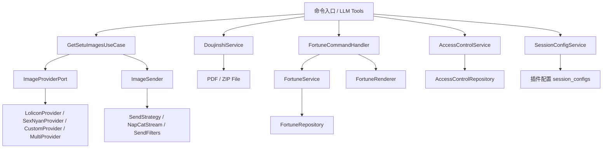

# 架构全景

## 分层结构

项目按 DDD 分层组织：

```text
src/
  domain/          # 实体、值对象、领域规则
  application/     # 用例、DTO、应用服务与端口接口
  infrastructure/  # 配置、持久化、provider、sender、AstrBot 适配
  shared/          # 配置模型、日志、发送缓存
templates/         # 运势卡片 HTML 模板与字体
tests/             # 单元与集成测试
```

## 启动结构

- `main.py`
  - 插件生命周期装饰器
  - 聊天命令入口和路由
  - LLM tool 注册
  - 不承载业务逻辑编排

- `src/infrastructure/astrbot/`：命令处理器、配置加载与运势渲染。
- `src/infrastructure/doujinshi/`：随机本子文件生成。
- `src/infrastructure/sending/`：发送策略、文件发送器与可恢复撤回队列。
- `src/infrastructure/config/`：配置迁移与自愈。

`main.py` 负责把 AstrBot 生命周期和命令接进来，`infrastructure/astrbot/` 负责具体适配。业务逻辑在 `application/` 和 `domain/`，不反向侵入入口。

## 核心运行链路

### 1. Setu 图片获取与发送

1. 命令、可配置短语或 LLM tool 触发，移除独立 `r18` 标记并校验会话分级 → `GetSetuImagesUseCase`
2. 用例通过 `ImageProviderPort` 获取图片 URL，并在下载暂时失败时按内部默认 3 轮对同一 URL 做确认重试
3. `ImageSender` 按策略发送：直接发送 / 合并转发 → 可选 NapCat 本地 `file://` 直通 → 确认失败后 NapCat 流式或 HTML 卡片 fallback → Docx 封装
4. 发送接口超时或 OneBot/NapCat 类适配器未返回 message id 时标记为可能仍在送达，不立即触发 fallback，避免延迟送达后重复发图
6. 缓存命中时复用本地文件，降低内存压力
7. 自动撤回内容含 `setu`、命中撤回范围且拿到 `message_id` 时，统一撤回调度器将任务写入 `revoke_tasks.json`，重启后按原到期时间调用 OneBot `delete_msg`

HTML 卡片默认通过 AstrBot 配置的 t2i 服务渲染。体积估算、压缩和卡片回退共用图片引用解析，详见[Base64 图片与 HTML 回退](sending-limits.md#base64-图片与-html-回退)。

### R18 DOCX 文件发送

`SetuCommandHandler` 使用已注入的插件数据目录创建 `R18DocxService`，
命令与 LLM 注册共用已初始化的 handler，两处 `ImageSender` 入口共用此服务。R18 DOCX 分支通过 `asyncio.to_thread()`
读取并封装全部图片，`DirectSendStrategy` 发送普通 `Comp.File`，
WebP 转换保留透明通道；成功、失败及 pending 沿用发送策略状态；取得的消息 ID 进入既有撤回调度。
生成或发送失败记录完整异常，并通过内置 `r18_docx_failed` 提示后结束分支。
UUID 文件名隔离并发请求，保存失败删除半成品。文件位于发送缓存目录，
保留完整 TTL（免容量淘汰），发送后安排 TTL 到期清理；缓存关闭仍可清理 DOCX。

### 2. Fortune 运势生成

1. 运势启用时，命令、短语或 LLM tool 触发 → `FortuneCommandHandler`
2. `FortuneService` 查询或生成今日运势记录
3. 有缓存图片时直接复用；否则获取背景、渲染模板、缓存卡片
4. 渲染失败降级为纯文本
5. 自动撤回内容含 `fortune` 时，OneBot 发送结果会登记到统一可恢复撤回队列

运势命令与 LLM 工具共用 `ImageSender` 的 `fortune` 内容类型，复用传输与压缩，但独立选择运势撤回策略。图片失败时返回文字运势，确认待定不重复发送。

### 3. 随机本子文件

1. `/随机本子 [标签...]` 与“来份标签本子”通过 `SetuCommandHandler` 复用 Setu 访问控制和标签解析
2. `DoujinshiService` 将每个解析后的标签作为重复 `tag` 参数调用随机本子 API，校验响应后按配置写入 PDF 或 ZIP；ZIP 成员按页码顺序命名
3. `build_doujinshi_file_chain()` 不区分平台，始终构造一个带标题文件名的普通 `File`，不创建 `Nodes` 或元数据文本节点
4. 自动撤回内容含 `doujinshi` 且 OneBot 群聊启用时，`DirectSendStrategy` 通过原始 `send_group_msg` 取得普通文件消息的 `message_id`，统一撤回调度器立即持久化消息任务
5. 所有新的消息撤回任务共同写入 `StarTools.get_data_dir()` 返回的运行目录；插件重启后按原绝对到期时间调用 OneBot `delete_msg`，不反查群文件
6. 生成文件写入同一插件运行目录，供 AstrBot 文件发送链路读取

### 4. 访问控制

1. 命令或 tool 触发前检查 `AccessControlService`
2. Setu 和 Fortune 独立判定
3. 两种功能模板分别按完整 SID 执行 `none`/`blacklist`/`whitelist` 判定
4. 不区分用户和群组，群聊规则约束整个会话；受限模式下缺少 SID 的旧运势记录跳过预生成
5. 黑白名单冲突在配置校验时拒绝，不提供运行态名单修改入口

### 5. 会话配置

1. 插件配置 `session_configs` 声明 `setu`／`fortune` 两种会话模板。
2. `SessionConfigService` 根据完整 `session_id` 只读解析，未指定的字段继承全局。
3. 请求、发送和运势背景共用解析规则；不存在运行态配置 CRUD。
4. 运势记录用可空 `session_id` 保存生成背景的会话上下文，预生成复用该值；缺失时使用全局，不改变用户／日期主键。

## 模块关系图



短语匹配使用 `domain/setu/triggers.py` 的字面模板；AstrBot 自定义过滤器只让匹配消息进入路由，避免未匹配消息被当作插件指令。工具按开关注册，调用时也检查开关。运势关闭时不初始化仓库，渲染器在实际渲染时创建；撤回队列独立恢复。

## 配置职责

### 插件配置

`_conf_schema.json` 暴露全局业务参数、provider 和平台模板、`safety` 权限模板及 `session_configs` 会话模板。配置模型位于 `src/shared/config/models.py`，保存后按 AstrBot 重载流程生效。

配置界面使用 `show_advanced` 显示开关与 AstrBot 原生条件显示，隐藏项仍参与保存和解析。卡片策略属于 `delivery.html_card_strategy`；多个图片源固定轮流使用，运势复用全局图片源。

缓存、卡片间距、补图轮次和传输分块采用固定默认，不作为隐藏可调设置。发送成功不追加文字提示；`/刷新运势` 刷新自己时返回固定确认；失败与拒绝类文案集中在 `src/shared/config/messages.py`，不再开放覆盖。

### 首次升级

`legacy_data_migration.py` 校验并迁移会话数据；旧裸 ID 权限无法可靠转换时阻止启动，需用户在插件配置中显式填写 SID 规则替换。全部校验后保存插件配置，最后写完成标记。任何一步失败都会阻止插件初始化，源文件保留。完成后只读插件配置，清空名单和删除模板不重新导入旧值。

## 数据与持久化

- 运势记录：SQLite（`FortuneRepository`）
- 访问控制：`ConfigAccessControlRepo` 只读插件配置 `safety` 模板列表
- 会话配置：插件配置 `session_configs` 模板；旧 JSON 仅作一次性迁移来源
- 发送缓存：磁盘文件（`send_cache.py`）
- 随机本子 PDF/ZIP：插件数据目录下的 `doujinshi/`
- 可恢复撤回任务（消息撤回，含本子普通文件消息）：插件数据目录下的 `revoke_tasks.json`
- 标签别名：配置模板（`tag_alias_templates`）

## 深入章节

- 运势领域细节：`src/domain/fortune/`
- 标签解析细节：`src/domain/setu/tag_resolver.py`
- Provider 适配细节：`src/infrastructure/providers/`
- Sender 策略细节：`src/infrastructure/sending/`
- 发送链路实测与传输上限：`docs/project/sending-limits.md`
- 访问控制细节：`src/domain/access_control/`、`src/infrastructure/persistence/access_control_repo.py`
